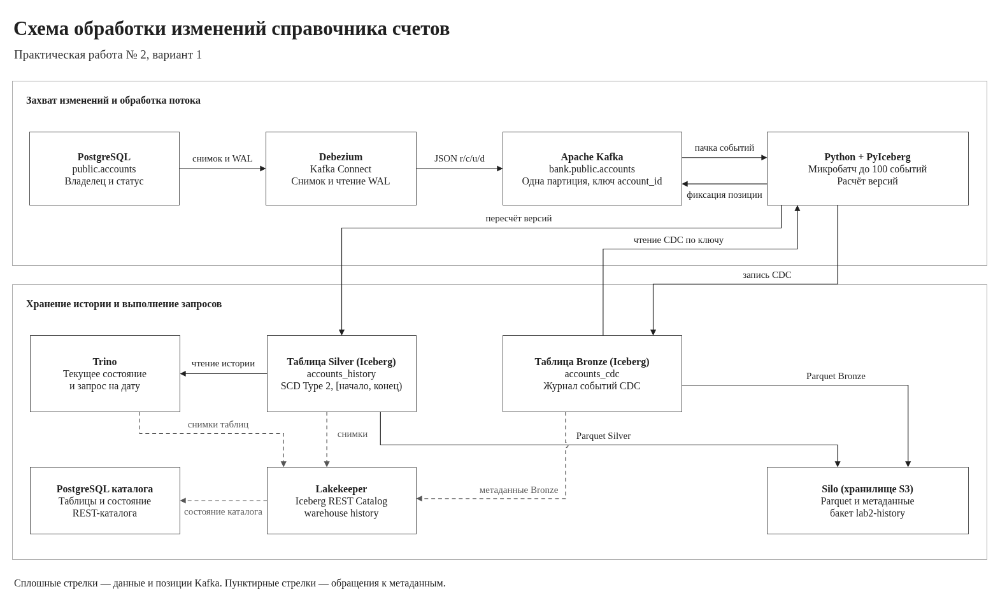

# Отчёт по практической работе № 2

**Илья Семёнов, группа БИВТ-24-СП-2**

## 1. Вариант и задача

| Поле | Значение |
| :--- | :--- |
| ФИО (как в VK Education) | Илья Семёнов |
| Тема | Вариант 1. История в справочнике (CDC → SCD → Lakehouse) |
| Состав решения | PostgreSQL, Debezium, Kafka, микробатчи на Python, Iceberg на Silo, Lakekeeper, Trino |
| Данные, объём | Синтетические счета с полями `account_id`, `owner_name` и `status`. До запуска CDC в базе два счёта. Каждый прогон добавляет отдельный тестовый счёт и меняет его в нескольких транзакциях. |

В PostgreSQL хранится текущее состояние счёта. Если заменить владельца обычным `UPDATE`, по справочнику уже нельзя проверить, кому принадлежал счёт вчера. Для бухгалтерии нужна история с датами начала и конца каждой версии. В примере счёт меняет владельца, замораживается, удаляется и открывается снова.

## 2. Источники и способы сбора

| Источник | Тип | Способ сбора |
| :--- | :--- | :--- |
| `public.accounts` в PostgreSQL, начальное состояние | Снимок | Debezium один раз читает таблицу при первом запуске и пишет по событию `r` на счёт. Это даёт исходную точку для истории. |
| Изменения `public.accounts` в PostgreSQL | CDC | Debezium читает WAL через логический слот `accounts_slot`. Публикация `accounts_publication` ограничивает поток изменениями таблицы счетов. В топик счетов после снимка поступают вставки, обновления и удаления. |

Снимок нужен, чтобы получить счета, которые ни разу не менялись с момента запуска CDC. После снимка регулярных полных чтений таблицы нет. `REPLICA IDENTITY FULL` даёт прежнюю строку в событиях обновления и удаления. Такой режим увеличивает объём WAL. Для построения версий хватило бы ключа при удалении и новых значений при изменении, а прежнюю строку я оставил в сыром журнале для разбора событий.

## 3. Архитектура



*Рис. 1. От захвата изменений до запроса к истории счёта.*

[Исходник draw.io](architecture.drawio).

Для счетов выбрал **SCD Type 2**. У версии есть начало `valid_from` и конец `valid_to`. При смене владельца старая версия закрывается и открывается новая. Для обновления без изменения владельца или статуса новой версии нет. Физическое удаление закрывает текущую версию, поэтому между удалением и повторным открытием есть разрыв. В Type 1 прошлые значения перезаписываются, а Type 6 дополнительно хранит текущие значения в исторических строках. Для запросов на дату мне достаточно интервалов Type 2. Подход Type 1 подошёл бы, например, для исправления опечатки в поле, по которому история не требуется.

У Kafka одна партиция. Это упрощает контроль порядка и позволяет хранить `kafka_offset` как ключ записи в Bronze. Обработчик берёт до 100 сообщений за один опрос длительностью до двух секунд. Микробатч нужен, чтобы группировать изменения одной записью таблицы и создавать меньше мелких файлов и коммитов Iceberg. Для такого стенда хватило Python и PyIceberg, отдельный Spark-кластер не понадобился. Непрерывная запись по одному событию сократила бы задержку на накопление пачки, но дала бы больше файлов и коммитов.

Интервалы строятся в UTC по времени изменения из `source.ts_us` Debezium. Первый снимок задаёт начальную точку наблюдения. Если время чтения строки снимка оказалось позже первого изменения, границу снимка сдвигаю к этому изменению. Если события одного счёта имеют одинаковое время, беру последнее по порядку в партиции Kafka. Это важно для нескольких изменений одного счёта в одной транзакции. Исходные события всё равно остаются в Bronze. Запрос на дату ищет версию по условию `valid_from <= дата AND (valid_to > дата OR valid_to IS NULL)`.

Bronze хранит сырой JSON и поля для разбора CDC. Silver хранит только историю владельца и статуса. Lakekeeper регистрирует таблицы и их снимки, Silo хранит Parquet и файлы метаданных. Trino читает Iceberg через тот же каталог, в который пишет обработчик.

## 4. Docker и проверка

Стенд проверен в виртуальной машине с Debian 12, 6 vCPU и 8 ГиБ памяти. Версии Docker и Compose приведены в выводе запуска.

| Блок | Статус |
| :--- | :--- |
| PostgreSQL с логической репликацией | Поднят. Таблица, тестовые строки и публикация созданы скриптом [source.sql](sql/source.sql). |
| Kafka и Debezium | Подняты. Коннектор снял исходное состояние и пишет изменения в `bank.public.accounts`. |
| Lakekeeper и отдельный PostgreSQL каталога | Подняты. `migrate` выполняет миграции и завершает работу с кодом 0. |
| Silo и Iceberg | Подняты. `setup` создаёт бакет и обе таблицы Iceberg, регистрирует коннектор и завершает работу с кодом 0. |
| Python-обработчик | Поднят. Пишет Bronze и Silver и подтверждает offset. |
| Trino | Поднят. Через SQL читаются обе таблицы. |

```bash
docker compose up -d --build
docker compose ps -a
docker ps --filter label=com.docker.compose.project=lab2-cdc
bash scripts/demo.sh
bash scripts/replay.sh 1000
docker compose exec -T -e TERM=dumb trino trino --output-format ALIGNED < sql/queries.sql
```

[Вывод docker ps и compose ps](results/docker-ps.txt) · [Демонстрация](results/demo.txt) · [Проверка повтора](results/replay.txt) · [Журнал обработчика](results/worker.txt) · [SQL-вывод](results/queries.txt).

Команды выше рассчитаны на первый прогон, когда тестовый счёт получает номер 1000. Для повторного прогона в команде `replay.sh` и в SQL нужно подставить номер, который напечатал `demo.sh`. В сохранённом выводе показан счёт 1001.

После вставки, смены владельца и заморозки появляются три версии счёта. Обновление без изменения полей и две смены статуса внутри одной транзакции новых версий не добавляют. Удаление закрывает третью версию, повторное открытие создаёт четвёртую. В Bronze сохранены все восемь событий счёта. Запрос на момент смены владельца возвращает Ивана Белова. В момент удаления результат пустой. В момент повторного открытия запрос возвращает Олега Смирнова.

Для проверки восстановления `replay.sh` меняет статус этого счёта на `CLOSED` и прерывает обработку после записи в Bronze. К этому моменту журнал содержит девять событий счёта, а в Silver ещё четыре версии и статус `OPEN`. После запуска основного обработчика последнее событие прочитано повторно. Для позиции Kafka 18 в журнале указано `bronze_new=0`. В Bronze по-прежнему девять уникальных событий счёта, а в Silver появилась пятая версия со статусом `CLOSED`. Код выхода 1 у контрольного контейнера ожидаем.

## 5. Путь данных

| Шаг | Для чего | Результат |
| :--- | :--- | :--- |
| 1. Снимок и чтение WAL | Получить исходные счета и дальше читать только изменения | Debezium отправляет JSON с `op`, `before`, `after`, временем и позицией в WAL. |
| 2. Kafka | Сохранить порядок доставки и дать обработчику возможность повторить чтение | Обработчик получает пачку с offsets из одной партиции. |
| 3. Bronze | Хранить события, из которых можно заново собрать историю | По offset добавляются только новые Kafka-записи. |
| 4. Silver | Собрать историю для затронутых счетов | Повторы операций источника определяются по LSN и данным транзакции. Для затронутых ключей пересчитываются интервалы, затем версии заменяются одним коммитом Iceberg. |
| 5. Подтверждение позиции | Продолжить чтение с нужного места после остановки | Offset подтверждается только после записи Silver. Повтор после сбоя приводит к тем же версиям. |
| 6. SQL в Trino | Узнать владельца и статус на нужную дату | Один и тот же запрос работает для текущих, закрытых и повторно открытых счетов. |

## 6. Выводы

Если подтвердить позицию до записи истории, после сбоя можно пропустить изменение. Поэтому обработчик сначала сохраняет событие, затем пересчитывает историю счёта и только после этого подтверждает позицию. Повторное чтение в проверке добавило пропущенную версию, а число событий в журнале осталось прежним.

Стенд показывает обработку повтора и историю на дату на небольшом наборе. Он рассчитан на одного брокера, одну партицию и один обработчик. Если сбросить Kafka и при этом оставить Iceberg, offsets могут начать повторяться, поэтому топик и таблицы нужно восстанавливать согласованно. История до первого снимка неизвестна. В рабочей системе я бы отдельно следил за размером WAL при отставании Debezium и за задержкой потребителя. При росте потока понадобятся несколько партиций с ключом `account_id`, составной ключ журнала и ограничение объёма пересчёта.

## Мой любимый десерт

Заживо варёные гуидаки.
https://encrypted-tbn0.gstatic.com/images?q=tbn:ANd9GcR1dq3uZdK6jsJ_MnTaYartauuDL7b-5MizxrRPDDk0IW_8pBYlV5R70Ws&s=10
